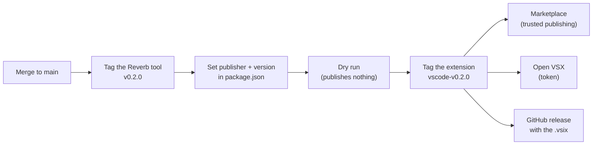

# Publishing the VS Code extension

Pushing a tag like `vscode-v0.2.0` runs [vscode-release.yml](../.github/workflows/vscode-release.yml). It tests the extension, packages it, publishes it to two stores and attaches the `.vsix` to a GitHub release:

- the **Visual Studio Marketplace**, which VS Code installs from, using **trusted publishing**: no token, no password, nothing stored in GitHub, and
- **Open VSX**, which VSCodium, Cursor, Windsurf, Gitpod and other VS Code builds use, with one token.

Your code stays on GitHub. You don't need Azure DevOps repositories, pipelines or a personal access token. Microsoft retires the old Azure DevOps tokens on 1 December 2026 anyway, which is why the workflow doesn't use one.



## Set up once

### 1. Create the Marketplace publisher

1. Go to https://marketplace.visualstudio.com/manage and sign in with a Microsoft account.
2. Choose **Create publisher** and fill in:
   - **ID**: lowercase letters, digits and hyphens, for example `muneeb-devp`. It can't be changed later, and it becomes part of the extension's ID: `<publisher-id>.reverb-notebooks`.
   - **Name**: what people see on the listing, for example "Muneeb Mughal".

If the page asks you to create an Azure DevOps organization while signing in, accept it. It's only an account container that Microsoft's sign-in uses; nothing of yours goes in it.

### 2. Tell the Marketplace to trust this workflow

This is the step that replaces the token.

1. On the same page, open your publisher and select the **Trusted Publishing** tab.
2. Expand **Create** and fill in:

   | Field | Value |
   |---|---|
   | Policy name | `Release workflow` (any name) |
   | Repository owner | `muneeb-devp` |
   | Repository | `reverb` |
   | Workflow | `vscode-release.yml` |
   | Environment | leave empty |

3. Select **Create**.

The values must match exactly, including the workflow file name, or the Marketplace refuses the publish. Only runs of that workflow in that repository can publish, and each run gets a credential that expires after 15 minutes, so there's nothing to leak or rotate.

If the repository is private, run the workflow within 48 hours of creating the policy; the first successful publish makes it permanent. This one is public, so that doesn't apply.

### 3. Open VSX: a namespace and one token

Open VSX is the only place that still needs a stored secret.

1. Go to https://open-vsx.org and log in with GitHub.
2. In **Settings**, link an Eclipse account (create one if needed) and sign the **Publisher Agreement**. Uploads are refused until it's signed.
3. Go to **Settings → Access Tokens → Generate New Token** and copy it.
4. Create the namespace. It must match your Marketplace publisher ID:

   ```sh
   npx ovsx create-namespace <publisher-id> -p <open-vsx-token>
   ```

5. Store the token as the one GitHub secret the workflow uses:

   ```sh
   gh secret set OVSX_PAT
   ```

   Paste the token when it asks. You can do the same in the repository's **Settings → Secrets and variables → Actions**.

I haven't checked whether Open VSX offers trusted publishing too. If it does, the workflow could drop this token as well. Until `OVSX_PAT` exists, the workflow skips Open VSX with a warning and still publishes to the Marketplace and creates the GitHub release, so this step can wait.

### 4. Set the publisher and version in the project

In [package.json](package.json):

- `"publisher"`: replace `REPLACE-WITH-MARKETPLACE-PUBLISHER-ID` with your publisher ID. The workflow stops with an error while the placeholder is there.
- `"version"`: the version to publish, for example `0.2.0`. Every release needs a new one; the stores refuse a version they already have.

Worth doing for a first release, none of it required:

- `"preview": true` shows a Preview badge on the listing. Remove it when you're happy calling it stable.
- `"keywords": ["notebook", "csharp", "dotnet", "reactive", "jupyter"]` helps people find it in the Extensions view (five at most).
- A `CHANGELOG.md` next to package.json fills the listing's Changelog tab. Add `!CHANGELOG.md` to [.vscodeignore](.vscodeignore), which lists what goes into the package.
- In [README.md](README.md), the listing's main page, say which Reverb.Notebooks version the extension needs.

Changes go through a pull request like any other.

## Releasing

1. **Merge to main.** Wait for CI to pass on Linux, macOS and Windows. Use "Rebase and merge" to keep the individual commits.

2. **Release the Reverb tool first**, if it changed. The extension runs `reverb serve --stdio`, which Reverb.Notebooks 0.1.1 and older don't have, so anyone installing the extension with an old tool would see "The installed Reverb is too old".

   ```sh
   git switch main && git pull
   git tag v0.2.0 && git push origin v0.2.0
   ```

   [release.yml](../.github/workflows/release.yml) publishes the NuGet packages. Wait until it's green and https://www.nuget.org/packages/Reverb.Notebooks shows the new version.

3. **Do a dry run.** In the repository's **Actions** tab, pick **vscode-release** and **Run workflow** on `main`. Run by hand, it builds, tests and packages but publishes nothing. Download the `.vsix` from the run's **Artifacts**, install it and try it:

   ```sh
   code --install-extension reverb-notebooks-0.2.0.vsix --force
   ```

   A dry run can't test the Marketplace sign-in. That only happens on a real tag.

4. **Publish.** The tag must match the version in package.json:

   ```sh
   git tag vscode-v0.2.0 && git push origin vscode-v0.2.0
   ```

   The workflow checks the tag, checks the publisher is set, runs the tests, publishes to the Marketplace, then to Open VSX, then creates a GitHub release with the `.vsix`. A version with a hyphen, such as `0.3.0-beta.1`, becomes a pre-release on GitHub.

5. **Check the listings.** The Marketplace scans a new extension first, which usually takes a few minutes:
   - https://marketplace.visualstudio.com/items?itemName=<publisher-id>.reverb-notebooks
   - https://open-vsx.org/extension/<publisher-id>/reverb-notebooks

Later releases are the same: bump `"version"` in a pull request, merge it, release Reverb.Notebooks first if the extension relies on something new in it, and push the matching `vscode-v` tag. The Marketplace's **Trusted Publishing** tab shows when each policy was last used.

## The very first publish

Microsoft's documentation doesn't say whether a brand-new extension's first publish can use trusted publishing, and I couldn't confirm it. Push the tag and see. If the Marketplace step fails and nothing has been published, upload the first version by hand instead, which needs no token:

1. Download the `.vsix` from the run's **Artifacts** (or build it with `npm run package` in `vscode/`).
2. On https://marketplace.visualstudio.com/manage, open your publisher and use **New extension → Visual Studio Code** to upload it.
3. Publish the next version with a tag, as above.

For the same release, the Open VSX step and the GitHub release didn't run, so publish those by hand: `npx ovsx publish reverb-notebooks-0.2.0.vsix -p <token>` and `gh release create vscode-v0.2.0 reverb-notebooks-0.2.0.vsix --generate-notes`.

## When something goes wrong

| What you see | What to do |
|---|---|
| "The tag vscode-v… is for version …, but vscode/package.json says …" | The tag and package.json disagree. Delete the tag (`git push origin :refs/tags/vscode-v0.2.0`, which needs admin rights because release tags are protected), fix one of them and tag again. |
| "vscode/package.json still has the placeholder publisher" | Set `"publisher"` and release again. |
| `TrustedPublishingNotSupportedException`, or a message that trusted publishing isn't supported | The Marketplace hasn't enabled it for the publisher yet. Check the policy exists on the **Trusted Publishing** tab, then see "The very first publish" above. |
| The Marketplace says no policy matches, or the token exchange is refused | A policy field differs from the run. Compare **Repository owner**, **Repository** and **Workflow** with the workflow's repository and file name, and leave **Environment** empty. |
| "Unknown publisher" | The publisher in package.json doesn't match the one you created. |
| `Unable to get ACTIONS_ID_TOKEN_REQUEST_URL` or similar | The job lacks `id-token: write`. The workflow has it at the top; don't remove it. |
| Open VSX says the namespace doesn't exist, or you aren't a member | Run the `create-namespace` command above with the publisher ID. |
| Open VSX says to sign the Publisher Agreement | Sign it in your open-vsx.org profile, then publish that store by hand as above. |
| "Version already exists" | That version is already published. Bump the version; the stores never take the same one twice. |
| The Marketplace published but Open VSX failed | Re-running the workflow would stop at the Marketplace, which already has the version. Publish Open VSX and the GitHub release by hand, as above. |

A published version can't be replaced. To take one back, publish a newer version with the fix. Unpublishing the whole extension is possible from the Marketplace's manage page, but people who installed it keep it.

Microsoft's own descriptions: [Publish Visual Studio Marketplace extensions securely with Trusted Publishing](https://developer.microsoft.com/blog/trusted-publishing-visual-studio-marketplace/) and [Publishing Extensions](https://code.visualstudio.com/api/working-with-extensions/publishing-extension).
