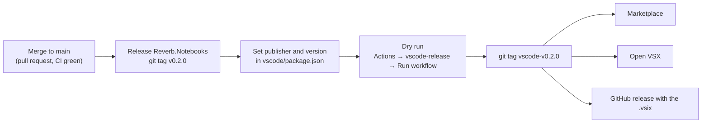

# Publishing the VS Code extension

The extension is published to two stores from one GitHub workflow:

- the **Visual Studio Marketplace**, which VS Code itself installs from, and
- **Open VSX**, which VSCodium, Cursor, Windsurf, Gitpod and other VS Code builds use.

Pushing a tag like `vscode-v0.2.0` runs [vscode-release.yml](../.github/workflows/vscode-release.yml), which tests the extension, packages it, publishes it to both stores and attaches the `.vsix` to a GitHub release. Most of this page is the setup you do once.



## Before the first release

### The extension needs a matching Reverb tool

The extension starts `reverb serve --stdio`. Reverb.Notebooks 0.1.1 and older don't have that command, so anyone who installs the extension with an old tool gets "The installed Reverb is too old". Publish a Reverb.Notebooks release that includes `reverb serve` first (step 2 below), and release both together from then on.

### Accounts and tokens

You need these once. Keep the tokens somewhere safe until they're stored as GitHub secrets.

**1. A Marketplace publisher**

1. Go to https://marketplace.visualstudio.com/manage and sign in with a Microsoft account.
2. Choose **Create publisher**. Fill in:
   - **ID**: lowercase letters, digits and hyphens, for example `muneeb-devp`. It can't be changed later, and it becomes part of the extension's ID: `<publisher-id>.reverb-notebooks`.
   - **Name**: what people see on the listing, for example "Muneeb Mughal".

**2. A Marketplace token**

The workflow publishes with a personal access token from Azure DevOps.

1. Go to https://dev.azure.com and sign in with the same Microsoft account. Create an organization if it asks; any name works.
2. Open **User settings** (the icon next to your avatar) → **Personal access tokens** → **New Token**.
3. Set:
   - **Organization**: All accessible organizations
   - **Expiration**: up to a year (put a reminder in your calendar)
   - **Scopes**: Custom defined → **Show all scopes** → **Marketplace** → **Manage**
4. Create it and copy the token. Azure DevOps shows it only once.

Microsoft has been changing how these tokens work. If any of this doesn't match what you see, follow [Publishing extensions](https://code.visualstudio.com/api/working-with-extensions/publishing-extension) in the VS Code docs, which is kept current.

**3. An Open VSX namespace and token**

1. Go to https://open-vsx.org and log in with GitHub.
2. In your profile (**Settings**), link an Eclipse account (create one if needed) and sign the **Publisher Agreement**. Open VSX won't accept uploads until it's signed.
3. Go to **Settings → Access Tokens → Generate New Token** and copy it.
4. Create the namespace. It must be the same as your Marketplace publisher ID:

   ```sh
   npx ovsx create-namespace <publisher-id> -p <open-vsx-token>
   ```

**4. Store the tokens as GitHub secrets**

```sh
gh secret set VSCE_PAT    # paste the Azure DevOps token
gh secret set OVSX_PAT    # paste the Open VSX token
```

or in the repository's **Settings → Secrets and variables → Actions → New repository secret**. The workflow reads exactly these two names.

### Changes in this repository

In [package.json](package.json):

- `"publisher"`: replace `REPLACE-WITH-MARKETPLACE-PUBLISHER-ID` with your publisher ID. The release workflow stops with an error while the placeholder is there.
- `"version"`: the version to publish, for example `0.2.0`. Every release needs a new version; the stores refuse a version they already have.

Worth doing for a first release, none of it required:

- `"preview": true` shows a Preview badge on the listing. Remove it when you're happy calling it stable.
- `"keywords": ["notebook", "csharp", "dotnet", "reactive", "jupyter"]` helps people find it in the Extensions view (five at most).
- A `CHANGELOG.md` next to package.json fills the listing's Changelog tab. Add `!CHANGELOG.md` to [.vscodeignore](.vscodeignore), which lists what goes into the package.
- In [README.md](README.md), which is the listing's main page, name the Reverb.Notebooks version the extension needs.

These changes go through a pull request like any other.

## Releasing

1. **Merge to main.** Open a pull request and wait for CI to pass on Linux, macOS and Windows. "Rebase and merge" keeps the individual commits.

2. **Release the Reverb tool**, if it changed since the last release:

   ```sh
   git switch main && git pull
   git tag v0.2.0 && git push origin v0.2.0
   ```

   [release.yml](../.github/workflows/release.yml) publishes Reverb.Notebooks and Reverb.Runtime to NuGet. Wait until it's green and https://www.nuget.org/packages/Reverb.Notebooks shows the new version (indexing can take a few minutes).

3. **Do a dry run.** In the repository's **Actions** tab, pick **vscode-release** and **Run workflow** on `main`. Run by hand, it builds, tests and packages the extension but publishes nothing. Download the `.vsix` from the run's **Artifacts**, then install and try it:

   ```sh
   code --install-extension reverb-notebooks-0.2.0.vsix --force
   ```

   Open a sample, run it, move a slider and look at a chart in a light and a dark theme.

4. **Publish.** The tag must match the version in package.json:

   ```sh
   git tag vscode-v0.2.0 && git push origin vscode-v0.2.0
   ```

   The workflow checks the tag against package.json, checks the publisher is set, runs the tests again, publishes to both stores and creates a GitHub release named "Reverb for VS Code 0.2.0" with the `.vsix` attached. A version with a hyphen, such as `0.3.0-beta.1`, becomes a pre-release on GitHub.

5. **Check the listings.** The Marketplace scans a new extension before it shows up, which usually takes a few minutes:
   - https://marketplace.visualstudio.com/items?itemName=<publisher-id>.reverb-notebooks
   - https://open-vsx.org/extension/<publisher-id>/reverb-notebooks

   Then search for "Reverb" in VS Code's Extensions view and install it from there.

## Later releases

Bump `"version"` in package.json in a pull request, merge it, and push the matching `vscode-v` tag. Release Reverb.Notebooks first whenever the extension relies on something new in the tool.

## When something goes wrong

| What you see | What to do |
|---|---|
| "The tag vscode-v… is for version …, but vscode/package.json says …" | The tag and package.json disagree. Delete the tag (`git push origin :refs/tags/vscode-v0.2.0`, which needs admin rights because release tags are protected), fix one of them and tag again. |
| "vscode/package.json still has the placeholder publisher" | Set `"publisher"` and release again. |
| `401` or "Failed request: Unauthorized" from `vsce publish` | `VSCE_PAT` is wrong, expired, or lacks the Marketplace → Manage scope, or wasn't made for "All accessible organizations". Make a new one and update the secret. |
| "Unknown publisher" | The publisher in package.json doesn't match the one you created on the Marketplace. |
| Open VSX says the namespace doesn't exist, or you aren't a member | Run the `create-namespace` command above with the same ID as the publisher. |
| Open VSX says to sign the Publisher Agreement | Sign it in your open-vsx.org profile, then re-run the failed job. |
| "Version already exists" | That version was published already. Bump the version; the stores never take the same version twice. |
| One store published and the other failed | Re-running the workflow would stop at the store that already has the version, so publish the missing one by hand from the run's `.vsix` artifact: `npx ovsx publish reverb-notebooks-0.2.0.vsix -p <token>` for Open VSX, or `npx vsce publish -p <token> --packagePath reverb-notebooks-0.2.0.vsix` for the Marketplace. Then create the GitHub release by hand if the run didn't get that far. |

A published version can't be replaced. To take one back, publish a newer version with the fix; unpublishing the whole extension is possible from the Marketplace's manage page, but people who installed it keep it.
